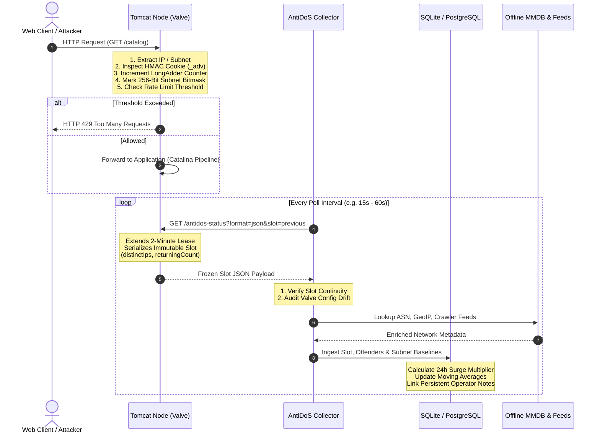
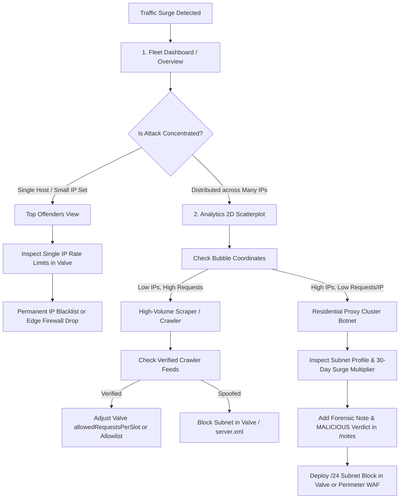

# Anti-DoS Collector & Fleet Architecture Guide

The **Anti-DoS Collector** is a high-throughput, standalone management, monitoring, and analytics service designed to aggregate security events, operational telemetry, and threat intelligence across a distributed fleet of **Anti-DoS-Valve** instances running inside Apache Tomcat servers.

---

## 📚 Documentation & Roles

The documentation suite is tailored for distinct operational roles:

* **[📖 Dashboard & Forensics User Guide (DASHBOARD_GUIDE.md)](DASHBOARD_GUIDE.md)**
  Comprehensive manual for **Security Analysts, Incident Responders, and Webmasters**.
  * Real-Time Fleet Overview, Monitored Server Detail Views & Configuration Drift
  * Visual Analytics Cockpit: Attack Timelines, Bot-Mix Composition & Traffic Breakdown
  * Forensic 2D Cluster Scatterplots (Residential Proxy Botnet Detection)
  * Subnet Profiling & Surge Detection (30-day moving baselines, surge multipliers, dormancy breakouts)
  * Persistent Operator Knowledge Store (`/notes` & forensic verdict badges)
  * Incident Explorer with multi-server CIDR filtering and exact time horizons
  * Verified Search Engine & AI Crawler Feed Verification

* **[⚙️ Setup, Deployment & Operations Guide (SETUP_GUIDE.md)](SETUP_GUIDE.md)**
  Technical reference for **DevOps Engineers, SREs, and System Administrators**.
  * Zero-Configuration Demo Mode Setup
  * Linux `systemd` Production Service Deployment
  * Frictionless GitHub Updates (`git pull` workflow with decoupled code, config, and data)
  * Database Engines (Embedded SQLite WAL mode vs. Enterprise PostgreSQL multi-server fleet)
  * Relational Database Schema, Data Models & Flyway Migrations
  * Offline IP Enrichment Setup (MaxMind / DB-IP MMDB & custom ASN threat overlays)
  * Automated Data Retention & Entity Hygiene Strategy
  * REST & Forensics API Reference

* **[🛡️ Tomcat Valve Core Documentation (Root README.md)](../README.md)**
  Low-level engineering reference for the Tomcat Valve engine (`AntiDoSValve`, `AntiDoSMonitor`, `AntiDoSCounter`).

---

## 🚀 Quickstart: Try the Fleet in 30 Seconds

Explore the complete multi-server fleet experience in **Demo Mode** with realistic traffic patterns, scraping waves, and residential proxy clusters without touching production systems:

```bash
# Package the collector uberjar
mvn package -pl collector -DskipTests

# Launch Demo Mode (pre-seeds 7 days of realistic attack waves and telemetry)
java -jar collector/target/anti-dos-collector-1.7.6.jar demo
```

Open **`http://localhost:8090`** in your browser.

---

# 1. High-Level Vision & Architecture: The Dual-Plane Ecosystem

Modern distributed web architectures face a fundamental conflict when defending against abusive traffic:

1. **Inline Edge Defense** must execute with **nanosecond-level latencies**, zero runtime dependencies, zero locks, and strictly bounded memory. A garbage collection pause, a blocking DNS lookup, or a database timeout inside a Tomcat request processing thread is catastrophic for legitimate users.
2. **Forensic Threat Intelligence & Anomaly Detection** requires **deep context, long-term history, external enrichment, and multi-node correlation**. Identifying a slow-and-low residential proxy botnet requires cross-server aggregation, GeoIP/ASN lookups, crawler validation, and 30-day moving averages.

The Anti-DoS ecosystem resolves this tension through a strict **Separation of Concerns: Data Plane vs. Intelligence Plane**.

```
                           ┌────────────────────────────────────────────────────────┐
                           │               CENTRAL INTELLIGENCE PLANE               │
                           │                 (Anti-DoS Collector)                   │
                           │                                                        │
                           │  • Long-Term Timeseries & DB Storage (SQLite/Postgres) │
                           │  • Deep Offline Enrichment (GeoIP, ASN, Org, Overlays) │
                           │  • Subnet Profiling & 30-Day Moving Baseline Surges    │
                           │  • Forensic 2D Cluster Scatterplots (Res-Proxy Heuristic)
                           │  • Verified Search Engine & AI Scraper Feed Sync       │
                           │  • Persistent Operator Knowledge Store (/notes)        │
                           └──────────────────────────┬─────────────────────────────┘
                                                      │
                               Pulls Finalized Slots  │  Maintains 2-Minute
                         (?format=json&slot=previous) │  Telemetry Lease
                                                      │
           ┌──────────────────────────────────────────┼──────────────────────────────────────────┐
           │                                          │                                          │
           ▼                                          ▼                                          ▼
   ┌──────────────────────────────┐        ┌──────────────────────────────┐        ┌──────────────────────────────┐
   │        DATA PLANE            │        │        DATA PLANE            │        │        DATA PLANE            │
   │  Tomcat Node 1 (Edge Valve)  │        │  Tomcat Node 2 (Edge Valve)  │        │  Tomcat Node N (Edge Valve)  │
   │                              │        │                              │        │                              │
   │ • Zero Allocation Hot Path   │        │ • Zero Allocation Hot Path   │        │ • Zero Allocation Hot Path   │
   │ • Hard Rate Limiting (HTTP 429)│      │ • Hard Rate Limiting (HTTP 429)│      │ • Hard Rate Limiting (HTTP 429)│
   │ • Lock-Free 256-Bit Bitmask  │        │ • Lock-Free 256-Bit Bitmask  │        │ • Lock-Free 256-Bit Bitmask  │
   │ • Visitor Cookie HMAC (_adv) │        │ • Visitor Cookie HMAC (_adv) │        │ • Visitor Cookie HMAC (_adv) │
   │ • Zero Long-Term History     │        │ • Zero Long-Term History     │        │ • Zero Long-Term History     │
   └──────────────────────────────┘        └──────────────────────────────┘        └──────────────────────────────┘
```

### The Edge Data Plane (Anti-DoS-Valve)
* **Mission:** Immediate, unyielding survival of the individual web application.
* **Operational Scope:** Knows only the immediate present (the active time slot and previous reference slot).
* **Guarantees:** Zero external dependencies, lock-free concurrency (`LongAdder`, atomic references), zero heap churn in the hot path. If an IP or subnet breaches thresholds, it is blocked instantly (`HTTP 429 Too Many Requests`).
* **Telemetry Role:** Acts as an ultra-efficient telemetry provider for the Collector, computing distinct IP bitmasks and visitor cookie ratios on the fly without storing historical state.

### The Central Intelligence Plane (Anti-DoS Collector)
* **Mission:** Long-term fleet visibility, multi-node correlation, trend analysis, and forensic intelligence.
* **Operational Scope:** Asynchronously polls many Tomcat nodes out-of-band via Java 21 Virtual Threads, capturing long-term time-series in a relational database.
* **Guarantees:** Completely decoupled from the servlet execution path. An outage, heavy analytical query, or database lock on the Collector has **zero impact** on Tomcat's ability to serve traffic and enforce edge rate limits.
* **Forensic Role:** Enriches raw IP events with ASN, Country, organization names, verified bot status, and baseline profiles to expose residential proxy botnets, AI scrapers, and stealthy crawling operations.

---

# 2. Division of Responsibilities & Information Processing

The power of this architecture stems from precisely deciding **what information is collected where, how it is compressed, and how it is enriched**.



---

## 2.1 Information Collected at the Edge (Anti-DoS-Valve)

The Valve maintains strictly bounded, lock-free in-memory counters for the current and recent time slots:

### 1. Sliding Time-Slot Engine
* Divides time into deterministic, non-overlapping windows (e.g. 60 seconds).
* Instead of storing timestamps for individual requests (which would consume unbounded memory during a DoS attack), incoming requests increment atomic `LongAdder` counters in `AntiDoSCounter`.
* Carries over a configurable decay percentage (`shareOfRetainedFormerRequests`) from previous slots to smooth transitions.

### 2. Lock-Free 256-Bit Subnet Bitmask (`distinctClients`)
* When `ipv4SubnetMask` is set to `24` (the industry-standard demarcation for residential and commercial subnets), an attacker rotating across hundreds of IPs in the same `/24` would slip under traditional single-IP rate limits.
* To detect this without allocating heap objects or `HashSet<String>` sets in the request thread, the Valve maintains an atomic 256-bit bitmask (`long[4]`, exactly 32 bytes per subnet counter).
* As requests arrive, the last octet of the IPv4 address (`0..255`) atomically sets the corresponding bit:
  $$\text{Bit Position} = \text{octet}_4 \pmod{256}$$
* **Telemetry Output:** In the JSON telemetry endpoint, the Valve computes `Long.bitCount()` across the four `long` words to report the exact number of distinct client IPs visiting that `/24` subnet.

### 3. Subnet-Bound HMAC Visitor Cookies (`returningCount`)
* Differentiating legitimate human shoppers from scraping bots is critical during high traffic.
* When `visitorCookieEnabled="true"`, the Valve issues a compact, cryptographically signed HTTP cookie (default name: `_adv`, customizable via `visitorCookieName`).
* **Cryptographic Subnet Binding:** The token contains an HMAC-SHA256 signature calculated over:
  $$\text{HMAC}(\text{Secret}, \text{ClientSubnet} \parallel \text{IssuedTimestamp})$$
  * Even if an attacker captures or copies a cookie, it cannot be reused from another subnet or distributed across a residential proxy botnet.
* The Valve verifies the token lock-free in memory. Valid tokens increment a lightweight `returningCount` in `AntiDoSCounter`.
* **Telemetry Output & Fleet Auto-Discovery:** The Valve reports cookie state (`visitorCookieEnabled`, `visitorCookieName`, `visitorCookieDomain`) directly in its overview telemetry (`?format=json`). The Collector dynamically discovers custom cookie names without requiring default `_adv`, automatically displaying `COOKIE: ACTIVE (<name>)` and tracking returning visitor ratios per subnet.

### 4. Dormant Telemetry via Rolling Collector Lease (`collectorIntegration="auto"`)
* Extended telemetry tracking (such as bitmask updates and cookie verifications) has an extremely low, but non-zero CPU and memory footprint.
* The Valve implements a dynamic **Collector Lease**:
  * When set to `auto` (default), extended metrics are collected only while an active lease is valid.
  * Whenever an Anti-DoS Collector queries the status endpoint (`?format=json`), the Valve refreshes a rolling 2-minute lease.
  * If no Collector polls within 2 minutes (e.g., the Collector is stopped for maintenance), the Valve silently enters a **zero-overhead dormant mode**, disabling extended bitmask processing until the Collector returns.

### 5. Immutable Slot Finalization (`slot=previous`)
* Querying live, actively incrementing counters in the current slot introduces race conditions and inconsistent numbers.
* The Valve's status endpoint supports `slot=previous`, returning the completely frozen, finalized previous slot along with its globally unique `slotKey`.
* This guarantees that the Collector ingests **100% deterministic, immutable historical slices** that are immune to network lag or poll timing jitter.

---

## 2.2 Information Aggregated & Enriched in the Collector

The Collector acts as the long-term memory, brain, and investigative workbench for the fleet:

| Layer | Responsibility | Value Added to Edge Telemetry |
|---|---|---|
| **Virtual Thread Scheduler** | Pulls all Tomcat endpoints in parallel | Prevents slow or hung nodes from delaying fleet collection; sequential requests per host prevent server strain. |
| **Monitored Valve Tracker** | Audits `AntiDoSValve` configuration attributes | Detects configuration drift across the fleet (mismatched thresholds, disabled cookies, differing slot lengths). |
| **Offline IP & ASN Enrichment** | Resolves ASN, Organization, and Country via local MMDB files | Zero external HTTP lookups in the query path; subnets are instantly grouped by Autonomous System (e.g., Cloudflare, OVH, Comcast). |
| **Automated Crawler Feed Engine** | Periodically syncs official IP ranges for Google, Bing, OpenAI, etc. | Differentiates legitimate search engine indexers and official AI crawlers from spoofed `User-Agent` impostors. |
| **Subnet Profiling & Surge Detection** | Computes 30-day moving daily baselines and hourly curves per subnet | Detects stealthy scraping surges (e.g. 5x normal volume) and dormancy breakouts from previously silent subnets. |
| **Forensic 2D Cluster Analysis** | Scatters subnets by Total Requests vs. Distinct IPs | Exposes residential proxy botnets (hundreds of IPs per subnet each sending only 1–3 requests to evade edge limits). |
| **Persistent Operator Knowledge (`/notes`)** | Stores manual analyst notes and forensic verdict badges | Completely immune to data retention cleanups; preserves institutional knowledge permanently across the fleet. |
| **Permanent Operational Reports (`/reports`)** | Compiles daily executive summaries & normalized peak performance metrics | Runs automatically at 01:00 AM before nightly retention cleanups; preserves fleet & server statistics in Markdown forever. |

---

# 3. Configuration Harmonization & Best Practices

To achieve optimal synergy between Tomcat Valves and the Collector, their configurations must be aligned.

## 3.1 Recommended Valve Configuration (`server.xml`)

Add the Valve inside your Tomcat `<Host>` element. For optimal fleet telemetry, activate subnet aggregation, visitor cookie tracking, and the dynamic collector lease:

```xml
<Valve className="org.henbru.antidos.AntiDoSValve"
       monitorName="Production-Web-Valve"
       description="Main Tomcat edge protection"
       relevantPaths="/"
       nonRelevantPaths=".*\.(css|js|png|jpg|jpeg|gif|ico|woff|woff2|svg)$"
       
       <!-- 1. Slot Timing & Thresholds -->
       slotLength="60"
       numberOfSlots="10"
       allowedRequestsPerSlot="300"
       shareOfRetainedFormerRequests="0.25"
       
       <!-- 2. Subnet Aggregation & Telemetry -->
       ipv4SubnetMask="24"
       ipv6SubnetMask="64"
       collectorIntegration="auto"
       
       <!-- 3. Subnet-Bound Visitor Verification -->
       visitorCookieEnabled="true"
       visitorCookieName="_adv"
       visitorCookieTtlSeconds="900"
       visitorCookieRefreshRatio="0.5"
       visitorCookieSameSite="Lax"
       visitorCookieSecure="auto"
       
       <!-- 4. Status Endpoint Security -->
       statusUri="/antidos-status"
       statusAllowedIPs="127\.0\.0\.1|::1|10\..*|192\.168\..*"
/>
```

---

## 3.2 Recommended Collector Configuration (`collector-config.yaml`)

Configure your Collector to poll the fleet at matching intervals:

```yaml
collector:
  # 1. Matching Poll Frequency (harmonized with Valve slotLength="60")
  poll-interval-seconds: 60
  parallel-fleet-polling: true
  slow-poll-threshold-ms: 1500

  # 2. Data Retention Hygiene
  retention-days: 30            # Retain high-resolution slot events for 30 days
  entity-retention-days: 60     # Keep network entity mappings for 60 days
  poll-log-retention-days: 2    # Background collector audit trail

  # 3. Telemetry Ingestion Rules
  default-valve-rules:
    collect-active: true        # Ingest active traffic counters for top offender analytics
    active-min-count: 5         # Discard sub-threshold noise below 5 requests
    active-limit: 1000          # Safety cap per slot to guard collector memory

  # 4. Fleet Endpoint Inventory
  servers:
    - id: "tomcat-prod-01"
      name: "Tomcat Production 01"
      base-url: "https://web1.internal.corp:8443"
      valves:
        - name: "Production-Web-Valve"
          status-path: "/antidos-status"
          auth-token: "${VALVE_SECRET_TOKEN}"

    - id: "tomcat-prod-02"
      name: "Tomcat Production 02"
      base-url: "https://web2.internal.corp:8443"
      valves:
        - name: "Production-Web-Valve"
          status-path: "/antidos-status"
          auth-token: "${VALVE_SECRET_TOKEN}"
```

---

## 3.3 Rule of Thumb for Parameter Alignment

| Parameter Concept | Valve Setting | Collector Setting | Rationale |
|---|---|---|---|
| **Time Horizon** | `slotLength="60"` | `poll-interval-seconds: 60` | Guarantees that every completed 60-second window is polled exactly once (`slot=previous`), eliminating gaps and duplicate counts. |
| **Subnet Aggregation** | `ipv4SubnetMask="24"` | Subnet Rollup (`/24`) | Aligns edge 256-bit bitmask cardinality tracking with the Collector's residential proxy cluster scatterplots. |
| **Telemetry Lease** | `collectorIntegration="auto"` | Continuous Polling | Keeps Valve telemetry active during operational monitoring, but automatically suspends Valve bitmask overhead if the Collector is taken down. |
| **Visitor Affirmation** | `visitorCookieEnabled="true"` | Analytics Bot-Mix View | Allows the Collector to break down traffic into verified returning visitors, legitimate crawlers, and unverified bot traffic. |
| **Storage Engine** | N/A (Stateless) | SQLite (WAL) vs. PostgreSQL | Use SQLite with WAL mode for small-to-medium clusters (1–10 nodes); use PostgreSQL for enterprise fleets (>10 nodes or high-concurrency analysts). |

---

# 4. Deep Forensic Workflows: From Telemetry to Action

When traffic spikes threaten availability, the synergy between Valve and Collector enables a structured, evidence-based triage workflow:



1. **Detection:** The Collector dashboard or surge monitor flags an anomaly (e.g. 24h Surge Multiplier > 5.0x).
2. **Cluster Isolation:** The analyst opens the **Analytics 2D Scatterplot** (`/analytics`) to inspect the distribution of *Total Requests* versus *Distinct IPs*.
   * If a `/24` subnet appears high on the Y-axis (e.g. 180 distinct IPs) with low average requests per IP, it is positively identified as a rotating residential proxy cluster.
3. **Intelligence Verification:** The analyst checks the **Crawler Feed** tab to ensure the traffic is not an official search engine (e.g. Googlebot) or AI crawler (e.g. GPTBot).
4. **Knowledge Retention:** The analyst opens the **Note Modal**, documents the attack signature, and assigns a **`MALICIOUS`** or **`SUSPICIOUS`** verdict badge. This note immediately overlays all dashboards, scatterplots, and event tables across the entire fleet.
5. **Mitigation:** The operator adds the offending CIDR to the Valve's `blockedIPs` or pushes the rule to edge load balancers.

---

# 5. Strategic Roadmap: Toward Closed-Loop Fleet Defense

The current architecture provides world-class edge protection coupled with centralized observability and forensics. The long-term vision extends this synergy into an **autonomous, closed-loop defense network**:

```
[ Phase 1: Edge Defense ]          [ Phase 2: Central Intelligence ]          [ Phase 3: Closed-Loop Defense ]
      (Completed)                               (Current)                                (Future Vision)
┌──────────────────────┐           ┌──────────────────────────────┐           ┌──────────────────────────────┐
│  • Standalone Valves │           │  • Asynchronous Ingestion   │           │  • Automated Feedback Loop   │
│  • Local Thresholds  │    ───►   │  • Offline GeoIP/ASN Lookup  │    ───►   │  • Fleet-Wide Blocklist Push │
│  • Hard 429 Drops    │           │  • Subnet Surge Profiling    │           │  • Adaptive Dynamic Limits   │
│  • In-Memory Slots   │           │  • Persistent Notes Archive  │           │  • Centralized WAF Sync      │
└──────────────────────┘           └──────────────────────────────┘           └──────────────────────────────┘
```

* **Automated Blocklist Push:** When the Collector detects a residential proxy cluster breaching surge thresholds across multiple nodes, it will push temporary, high-priority block rules directly to all Valves in the fleet via an authenticated management channel.
* **Adaptive Fleet Thresholds:** During site-wide flash sales or marketing campaigns, the Collector will coordinate dynamic threshold adjustments across all nodes, preventing false positives while maintaining protection against actual DoS attacks.
* **Centralized WAF & Edge Integration:** Exporting validated malicious subnets and residential proxy clusters directly from the Collector into cloud WAFs (Cloudflare, AWS WAF) or perimeter firewall rules (iptables/nftables) via automated webhooks.

---

## 🛠️ Technology Stack & Concurrency Model

* **Edge Valve:** Java 17 / 21, Apache Tomcat Catalina API, Zero 3rd-party dependencies, Shaded dual-build (Tomcat 10 `jakarta.servlet` & Tomcat 9 `javax.servlet`).
* **Collector Core:** Java 21, Spring Boot 3.3+, Project Loom Virtual Threads (`Executors.newVirtualThreadPerTaskExecutor()`).
* **Persistence & Schema:** SQLite with Write-Ahead Logging (`WAL`) mode or Enterprise PostgreSQL, automated schema versioning with Flyway.
* **Frontend Cockpit:** Server-rendered Thymeleaf 3, Reactive HTMX, Chart.js for canvas visualizations, 100% self-contained air-gapped styling with zero Node.js/npm runtime dependencies.
* **IP Intelligence:** MaxMind GeoLite2 / DB-IP offline database readers (`.mmdb`), asynchronous crawler IP feed synchronizers.

---

## 📄 License & Open Source Attribution

Anti-DoS-Valve and Anti-DoS-Collector are open-source software licensed under the **Apache License, Version 2.0**.
Third-party component licenses, vendored scripts, and copyright notices are documented in [NOTICE.md](../NOTICE.md).
